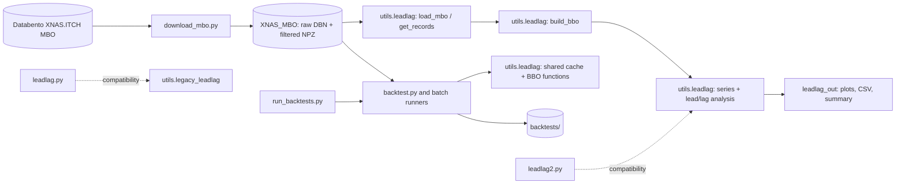

# Orderbook_building
Building order book from Databento BBO data

See [the project guide](docs/PROJECT_GUIDE.md) for data downloads, cache creation,
backtest commands, output interpretation, and research limitations. For the
generic parallel MBO downloader, including date-range and worker options, see
[Download and cache MBO data](docs/PROJECT_GUIDE.md#download-and-cache-mbo-data).
See [strategies.md](strategies.md) for the experiments run so far and their
saved results.
For the FN6908 Track A mini-project framing, research questions, and proposed
analysis, see [the project plan](docs/mini_project_track_a_plan.md).

For a standalone comparison of book pressure across TSLA and its three ETFs,
including held-out price prediction and a spread-cost hurdle, run
`python analyze_book_pressure.py --workers 1 --resume`. Tables, a report and
four PNG/SVG charts are saved to `leadlag_out/book_pressure_20260701_20260930/`.
See [the pressure analysis guide](docs/PROJECT_GUIDE.md#standalone-book-pressure-predictive-analysis)
for the definition, chronological train/test split and limitations.

For quarter-wide Analysis C response curves and t50/t90 timing estimates,
run `python analyze_impulse_batch.py --workers 1 --resume`. Results and PNG/SVG
charts go to `leadlag_out/impulse_20260701_20260930/`; see the
[multi-session Analysis C guide](docs/PROJECT_GUIDE.md#analysis-c-across-multiple-sessions).

## How the repository fits together

The downloader stores raw daily files and filtered record caches. Analysis and
backtests share the reusable code in `utils/`; root-level `leadlag*.py` files
are kept as compatibility entry points.



Start with [the project guide](docs/PROJECT_GUIDE.md#project-map) for a file-by-file
overview, setup instructions, and runnable examples.

## Event-driven strategy backtest

`backtest.py` provides a point-in-time backtest scaffold using the filtered MBO
cache created by `utils.leadlag`. The included example enters long/short TSLL,
TSLR, or TSLG when TSLA's trailing mid-price return crosses a threshold. It
waits for an ETF quote strictly after the signal plus latency, crosses the
displayed ask/bid, holds for the configured interval, and crosses the opposite
side to exit. Orders are skipped if displayed top-level size is insufficient.

Example for the available October 9 data:

```sh
python3 backtest.py --day 20261009 --symbol TSLL \
  --lookback-ms 100 --threshold-bps 5 --hold-ms 1000 \
  --latency-ms 1 --quantity 100 --fee-per-share 0
```

To try the ETF-vs-TSLA mispricing example instead:

```sh
python3 backtest.py --day 20261009 --symbol TSLL --strategy mispricing \
  --mispricing-entry-bps 30 --mispricing-exit-bps 5 \
  --max-hold-s 30 --latency-ms 1 --quantity 100
```

Run the same mispricing settings over the cached October 5–9 sessions and all
three ETFs with:

```sh
python3 backtest_batch.py
```

The batch runner saves per-day trades plus daily and aggregate summaries under
`backtests/20261005-20261009/`, with separate folders for each entry threshold.

Compare touch fills with visible-depth execution bounds and several order sizes:

```sh
python3 backtest_execution_sensitivity.py \
  --start-day 20261005 --end-day 20261009 \
  --quantities 100 500 1000 5000 --levels 10
```

The sensitivity runner freezes the one-share strategy's signals and exit
conditions, then compares top-of-book fills, partial-entry depth sweeps, and
all-or-complete depth sweeps. It writes scenario trades, fill rejection
diagnostics, and summaries under `backtests/execution_sensitivity/`. Since the
signals are frozen, it isolates execution effects but does not model how
rejected orders would change later positions or signals. More details and the
sample outcome are in [strategies.md](strategies.md#execution-fill-sensitivity).

This estimates an intraday fair price from the first jointly observable TSLA
and ETF quotes, then scales TSLA's subsequent return by the ETF's daily leverage
target. It buys when the ETF is sufficiently below that estimate and shorts
when it is sufficiently above. The exit occurs when the gap converges or the
maximum holding time expires.

The trade log and summary are written under
`backtests/<day>/<symbol>/<strategy>/` (or the path passed with `--out`).
Costs from crossing the spread are included in fills; `--fee-per-share` adds
commissions. This first version uses only Nasdaq's displayed top of book, so it
does not model consolidated NBBO, deeper-book impact, queue priority, hidden
liquidity, short borrow costs, or fund operating expenses. One day of results
is a mechanics check, not evidence that a strategy has an edge.

## Run all backtests over a date range

`run_backtests.py` runs the baseline residual, momentum/reversal, imbalance,
queue-maker, and execution-sensitivity runners over one inclusive date range.
Each runner splits the range into daily child processes controlled by
`--workers`. Select a subset with `--strategies`. For example:

```sh
python3 run_backtests.py \
  --start-day 20260701 --end-day 20260930 --workers 2 \
  --out-dir backtests
```

July 3 and September 7 are skipped by default. Results go into separate
strategy folders under `backtests/20260701-20260930/`. The wrapper runs one
strategy at a time and parallelizes its independent sessions. Start with a low
worker count because each process loads a full day's MBO cache; `--workers 1`
runs sessions inline.
